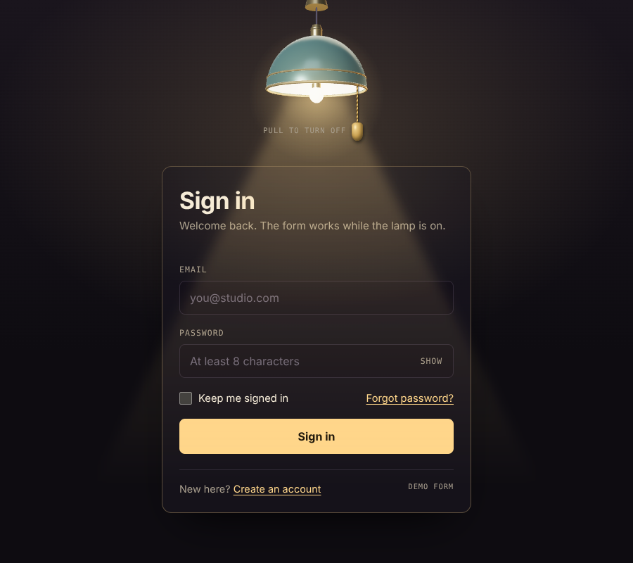
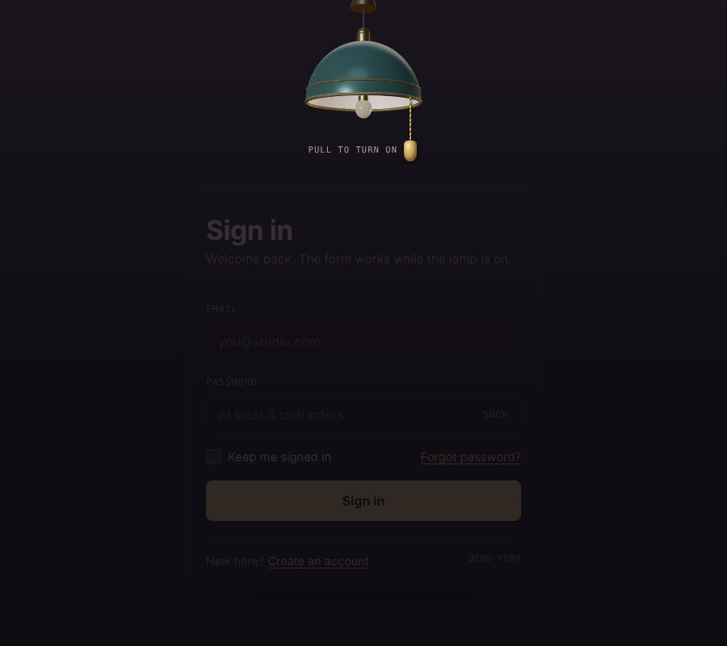
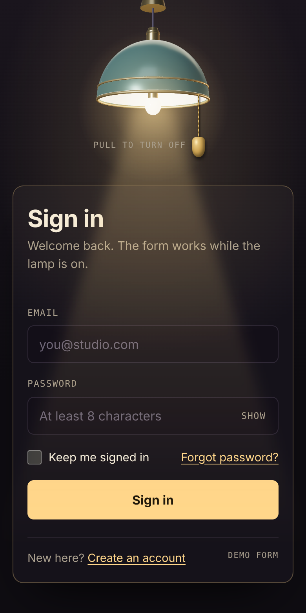

# Lamp Login

A sign-in form under a hanging 3D lamp. Pull the cord to switch the light: the beam falls across the card and the form comes alive. Switch it off and the form fades into the dark.

It is one self-contained file (`index.html`), with no build step and no framework.

**Live demo:** https://jaisudhakar.github.io/lamp-login/
(Turn on GitHub Pages for this repo first: *Settings → Pages → Deploy from a branch → `main` / root*.)

| Light on | Light off |
| --- | --- |
|  |  |

<p align="center">
  
</p>

## Features

- **Real 3D lamp** drawn with [three.js](https://threejs.org/): a dome shade in glossy green enamel with a white lining, brass trim, a glass bulb, a socket, a wire and a ceiling rose. Reflections come from a small generated environment map, and a point light sits in the bulb.
- **Pull cord** that you can drag down, tap, or operate from the keyboard.
- **Light animation**: the bulb flickers on, the lamp swings like a pendulum, and the beam, glow and card fade in and out.
- **Sign-in form** with email and password validation, show/hide password, a loading state, and a success screen.
- **Fallback lamp**: if WebGL or the three.js download is unavailable, a flat SVG lamp is shown instead and everything else still works.
- **Responsive**: no horizontal scroll down to phone widths.
- **Accessible**: labelled controls, visible focus states, `aria-invalid` and live error messages, a screen-reader announcement ("Light on" / "Light off"), and `prefers-reduced-motion` support.

## Run it

Open `index.html` in a browser. That is all.

If you prefer a local server:

```bash
python3 -m http.server 8000
# then open http://localhost:8000
```

An internet connection is needed for two things, and the page still works without them:

- three.js (r128) from cdnjs. Without it you get the SVG lamp.
- The Bricolage Grotesque and DM Mono fonts from Google Fonts. Without them the page uses system fonts.

## How to use it

| Action | Result |
| --- | --- |
| Drag the brass bead down about 26 px | Toggles the light (the cord stretches up to 44 px, then springs back) |
| Click or tap the bead | Toggles the light |
| Tab to the bead, press Enter or Space | Toggles the light |
| Light on | The form is usable |
| Light off | The form is dimmed and disabled (`inert`), so it cannot be focused |

Form rules:

- Email must look like `name@domain.tld`.
- Password must be at least 8 characters.
- A valid submit shows a 0.9 second loading spinner, then a "You're in" screen with a back button.

## This is a front-end demo

The form does not send anything anywhere. The submit handler stops the default submission and shows the success screen. To connect it to a real backend, replace the body of the `setTimeout` inside the `submit` listener (near the end of the script) with your request:

```js
form.addEventListener('submit', async function (e) {
  e.preventDefault();
  // ...validation stays as it is...
  const res = await fetch('/api/login', {
    method: 'POST',
    headers: { 'Content-Type': 'application/json' },
    body: JSON.stringify({ email: v, password: pw.value, remember: document.getElementById('remember').checked })
  });
  // handle res, then show the done view or an error
});
```

Never put real credentials or API keys in this file.

## Customising

Everything lives in `index.html`.

**Colours and fonts** are CSS variables at the top of the `<style>` block:

```css
:root {
  --room: #0e0c11;          /* page background */
  --shade: #2a4239;         /* SVG fallback shade colour */
  --brass: #c9a050;         /* trim, cord and bead */
  --light-rgb: 255 214 138; /* beam, glow and focus colour (space-separated RGB) */
  --light: #ffd68a;         /* button and link colour */
  --ink: #f5eddc;           /* main text */
  --display: 'Bricolage Grotesque', ...;
  --mono: 'DM Mono', ...;
}
```

**The 3D lamp** is built in the `initLamp3D()` function in the script:

| What | Where to change |
| --- | --- |
| Shade size and shape | `SR` (radius), `SH` (height), `TOP` (top of the dome) |
| Shade enamel colour | `enamel` material, `color: 0x2b5445` |
| Lining, brass, bulb glass | `lining`, `brass` and `glass` materials |
| Light strength | `apply()`: `bulbLight.intensity`, `glass.emissiveIntensity`, `key.intensity` |
| Bulb light colour | `new T.PointLight(0xffd08a, ...)`, keep it close to `--light-rgb` |
| Camera angle | `camera.position` and `camera.lookAt` (how much of the shade's underside shows) |

**Layout and motion**

- `.lamp` is the 220 × 200 px box the lamp hangs in. `.lampgl` is the 260 × 230 px canvas drawn over it, and `W` and `H` in `initLamp3D()` must match.
- The beam, the bloom and the pull cord are normal HTML. After building the 3D scene, the script projects the bulb and the shade rim into screen pixels and positions them (`--bulb-y` and the cord's `left` and `top`), so they stay aligned if you change the lamp.
- `@keyframes swing` sets the pendulum motion and `@keyframes flick` sets the flicker. `FL` in the script mirrors the flicker keyframes so the 3D light flickers in step with the CSS glow.

## How it works

1. A transparent WebGL canvas renders the lamp with a perspective camera set slightly below the shade, so you can see inside the rim.
2. A smoothed brightness value (0 to 1) drives the point light in the bulb, the bulb glow, the lining glow and the reflections. On turn-on it follows the flicker curve instead.
3. CSS handles the beam (a blurred, clipped gradient cone), the bloom around the bulb, the card fade, and the pendulum swing, which rotates the whole lamp group from the ceiling point.
4. The `on` class on the stage element is the single source of truth. It drives the CSS, the 3D light, the `aria-pressed` state and the `inert` attribute on the card.

## Browser support

Any current Chrome, Edge, Firefox or Safari with WebGL. Older browsers and devices without WebGL show the SVG lamp.

## Files

```
index.html        the whole page: markup, styles and script
docs/             screenshots used in this README
```

## Credits

- [three.js](https://threejs.org/) r128, loaded from cdnjs
- [Bricolage Grotesque](https://fonts.google.com/specimen/Bricolage+Grotesque) and [DM Mono](https://fonts.google.com/specimen/DM+Mono) from Google Fonts

Built with Claude.
